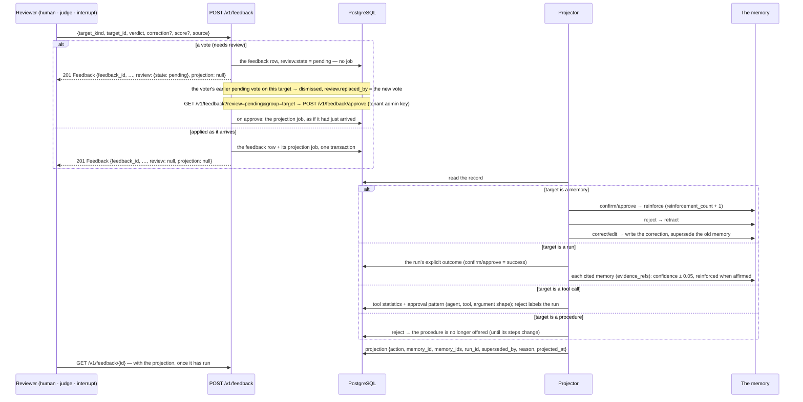

# Feedback: a judgement, and what it changes

Feedback is not a rating column. A verdict on a **memory** changes that memory — it is reinforced,
retracted, or superseded by a correction; a verdict on a **run** is its explicit outcome, and moves the
confidence of the memories its answer cited (`evidence_refs`); a verdict on a **tool call** counts toward the tool's statistics and its approval
pattern; rejecting a **procedure** stops it being offered. Human verdicts, judge verdicts, interrupt
decisions and a run's own status land in one table with one shape, so nothing downstream has to
know which it was reading (ADR 0023).

**An end user's 👍/👎 waits for review before it changes anything (ADR 0028, amended by
ADR 0039).** A vote on a run, a memory or a procedure from a person (or an agent carrying one) is
stored with `review.state=pending` and changes nothing — no confidence, reinforcement, ranking,
run outcome, learned skill, procedure or index — until the tenant's administrator approves it.
A voter counts once per target: their newer vote replaces their earlier pending one. What is
automated stays immediate: a run's own status, tool-call decisions, the service's own
`/v1/verify` verdict and the administrator's own word. See
[Review](#review-what-applies-now-and-what-waits).

## From verdict to consequence



The projection is a separate, later fact, which is why `GET` is worth doing: a `POST` answers
before the projector runs, so the record you get back has `projection: null`.

An answer's `evidence_refs` name what it cited (`{"source_type": "memory", "source_id":
"mem_…"}`; `source_type` is one of the service's evidence sources: `memory`, `message`, `file`,
`document_chunk`, `agent_result`, `tool_result`, `import`, `observation`, `statement`,
`graph_fact`, `summary`, `episode`, `feedback`); each must be a memory the reviewer may read, or the `POST` is refused. Memory
standing — confidence and reinforcement — is part of the retrieval ranking: a bounded factor
(at most ±15%) on the fused score, so it reorders near-ties and never outweighs relevance.

## Routes

| Route | Purpose | SDK |
| --- | --- | --- |
| `POST /v1/feedback` | record a judgement on a run, memory, tool call or procedure | `ctx.feedback(...)` |
| `GET /v1/feedback/{feedback_id}` | one record, with its projection once it has run | `ctx.feedback.get(id)` |
| `GET /v1/feedback?target_kind=…&target_id=…` | the feedback on one target, newest first (cursor paged) | `ctx.feedback.page_for(...)` |
| `GET /v1/feedback?review=pending` | the review queue (tenant admin key): verdicts that change nothing until approved, newest first, each with `author_record` | `ctx.feedback.pending(limit=…, cursor=…)` |
| `GET /v1/feedback?review=pending&group=target` | the queue grouped: one row per target with `votes`, `thumbs_up`, `thumbs_down`, distinct `voters` and `latest_at`, the most recently voted first | `ctx.feedback.pending(group="target")` |
| `GET /v1/feedback?review=dismissed` | the verdicts in another review state (`approved`, `dismissed`), for reporting; `group=target` works here too | `ctx.feedback.pending(review="dismissed")` |
| `GET /v1/feedback/pending` | **deprecated** alias of the queue, answered with `Deprecation: true` and `Link: rel="successor-version"` | — |
| `POST /v1/feedback/{feedback_id}/approve` | apply a pending verdict as if it had just arrived; optional `{"note": …}`; 409 when it is not pending | `ctx.feedback.approve(id, note=…)` |
| `POST /v1/feedback/{feedback_id}/dismiss` | keep a pending verdict for statistics, never apply it; optional `{"note": …}`; 409 when it is not pending | `ctx.feedback.dismiss(id, note=…)` |
| `POST /v1/feedback/approve` | approve in bulk: `{"feedback_ids": […]}` (1 to 500) or `{"target_kind": …, "target_id": …}` (every vote pending on it); idempotent | `ctx.feedback.approve_many(ids)`, `ctx.feedback.approve_many(target_kind=…, target_id=…)` |
| `POST /v1/feedback/dismiss` | dismiss in bulk, the same body | `ctx.feedback.dismiss_many(…)` |

## The vocabulary

| Field | Values |
| --- | --- |
| `target_kind` | `run` · `memory` · `tool_call` · `procedure` |
| `verdict` | `confirm` · `reject` · `correct` · `approve` · `edit` |
| `source` | `human` · `judge` · `interrupt` · `system` (a run's own final status, as the harness reports it; its success is the run's outcome only, no evidence for learning until a judge or a person confirms it) |

`approve` and `edit` are the interrupt vocabulary: a person approving a tool call, or approving it
with different arguments, is feedback as much as a thumbs-up is — and recording it that way is what
lets "what did people actually let this agent do?" be answered later.

## Submitting

```python
# a person corrects a memory
await ctx.feedback(
    "memory",
    memory_id,
    "correct",
    correction="The reorder threshold is 12 days, not 10.",
    comment="confirmed with planning",
    reviewer="planner-7",
)

# an external judge scores a run: a client-claimed source="judge" is a vote, so it waits
# for review (only the service's own /v1/verify verdict is applied as it arrives)
vote = await ctx.feedback(
    "run",
    run_id,
    "confirm",
    score=0.93,
    source="judge",
    reviewer="judge:gpt-4.1-nano",
)
print(vote.review.state if vote.review else "applied")  # "pending"

record = await ctx.feedback.get(feedback_id)
print(record.projection.action if record.projection else "not projected yet")

page = await ctx.feedback.page_for("memory", memory_id, limit=50)
print([f.verdict for f in page.items], page.next_cursor)
```

The identity fields — tenant, workspace, user, agent, agent run — come from the bound context and
nothing else of the scope travels in the body. `reviewer` is a label, not an identity: a machine
verdict is `source="judge"` with `reviewer="judge:<model>"`, so no human is ever credited with a
model's opinion.

A retry with the same `feedback_id` (or an `Idempotency-Key`) returns the stored record rather than
writing a second one — which matters for a judge that samples the same run twice.

## Review: what applies now and what waits

Applied as it arrives (`review: null`), because none of these is an end user's vote:

* a run reporting its own status: `source="system"`, `target_kind="run"`, the target is the
  calling scope's `agent_run_id`, it cites no memories (`evidence_refs` empty), and the
  credential may act as that agent (an issued key whose `may_act_as` allows it, as the
  harness's does) — the lowest-ranked word on a run, which never overrides a person or the
  judge. No credential is bound to one run, so this is as strong as the key: a bearer token
  from an identity provider names a person, and a `system` verdict sent with one waits like
  a vote;
* an owner's `correct` or `edit` of their own memory carrying new text (a string or
  `{"content": …}`) — an edit, limited to the owner, the user an agent acts for, or a tenant
  admin in person (an agent acting for an admin edits only its own user's memories), the rule
  that governs forgetting;
* any verdict on a `tool_call` (what it teaches is an approval *suggestion*, which changes
  nothing until it is accepted — [tools.md](tools.md));
* anything sent with the tenant's admin key (or the platform key), or by a tenant admin user
  in person (never an agent acting for one).

`DELETE /v1/memories/{id}` is not feedback: erasure applies at once.

Everything else waits (`review.state = "pending"`): every `source="judge"` verdict — the
service's own grounding judge's, the one `POST /v1/verify` records on a run, included,
whoever's key carried it — a `confirm`/`approve` **or a `reject`** of a memory by a non-admin —
the owner's thumbs-down included, and a `correct`/`edit` whose correction carries no text — a
verdict on a run from a person or a client (including a `system` verdict that cites memories,
names another run or comes from a credential that may not act as the agent), and any verdict
on a procedure.

The grounding judge's verdict never raises a memory's confidence: the answer was checked
against the memories it was given, so its `confirm` cites none (it would only echo them back).
Its `reject` cites only the memories that contradict one of the answer's claims, never one a
supported claim rests on, and none at all when the run recorded tool calls: such an answer
rests on the tools' results, which the context it was checked against never held. Approved, a
run verdict moves the memories it cites only when it labels the run: one a higher-ranked
source outranks changes nothing.

While a vote waits it changes nothing: the memory stays current with the same confidence and
reinforcement (so ranking does not move), its index entry and the cached bundles that show it
are untouched, the run has no outcome from it, and no skill is learned from it.

### One vote per voter per target

A voter's newer vote on the same target replaces their earlier pending one: the earlier is
kept as `review.state = "dismissed"` with `review.note = "replaced by a newer vote from the
same user"` and `review.replaced_by` naming the newer vote (and a `projection` of `none`), never
applied, so repeated clicks count once and a changed mind is the vote that
waits. The voter is the person (`user_id`), whichever agent carried the vote; an agent with no
person behind it is a voter of its own. A vote already decided is not replaced, and two
people's votes on one target are two votes. A retry with the same `feedback_id` replaces
nothing. What is a vote is decided by who sent it, never by the `source` it claims: a verdict
on a run, a memory or a procedure is a vote unless it is the administrator's or the service's
own word, a run's status or a judge's word sent with a credential that may act as that agent,
or an edit of a memory carrying new text. So `source="judge"` written on a thumb by a person's
client is still that person's one vote, and an automated record never replaces a thumb, nor
the reverse.

The rule holds across approvals too. A vote with the same thumb as the voter's vote already
approved on the target changes nothing: it is stored `dismissed` under the id the client sent,
with `review.note = "the same vote from the same user already counts"` and
`review.replaced_by` naming the vote that counts, and the voter's pending change of mind, if
any, is withdrawn the same way. A flipped vote waits; approving it first undoes the effect of
the voter's vote that was actually applied - a reinforcement taken back, a retraction it made
lifted, the confidence it moved on a run's cited memories moved back, a procedure it rejected
offered again - and then applies its own, so `projection.reversed` names the vote it undid. An
earlier vote that was approved but whose job had not run yet never applies: the newer one
closes it first (`projection.reason` "replaced by a newer vote from the same user").

What undoing does not restore exactly:

* a step clipped at a bound is undone by the full step, not by what the clip took - a
  memory at confidence 0.95 reinforced to 1.0 (+0.05) and then voted down ends at 0.9, not
  0.95; away from the bounds a step and its undoing cancel;
* a procedure is offered again as `active`, whatever it was before the rejection.

A replaced vote is not a review state of its own, so a client that knows pending, approved and
dismissed reads every record. `author_record` counts only what reviewers decided, and the
grouped queue counts votes, not the clicks a voter replaced.

The tenant's administrator works the queue with the admin key, one target at a time:

```python
admin = MemoryClient(url, api_key=tenant_admin_key).bind()  # the key names the tenant
targets = await admin.feedback.pending(group="target", limit=50)
for t in targets.items:
    print(t.target_kind, t.target_id, t.thumbs_up, t.thumbs_down, t.voters, t.latest_at)
    if t.thumbs_down > t.thumbs_up:
        await admin.feedback.dismiss_many(target_kind=t.target_kind, target_id=t.target_id)
    else:
        await admin.feedback.approve_many(target_kind=t.target_kind, target_id=t.target_id)
```

or one vote at a time:

```python
page = await admin.feedback.pending(limit=50)
for vote in page.items:
    print(vote.target_kind, vote.target_id, vote.verdict, vote.source, vote.author_record)
    # author_record: how this author's verdicts fared in review - {pending, approved, dismissed}
    await admin.feedback.approve(vote.feedback_id, note="matches the signed contract")
    # or: await admin.feedback.dismiss(vote.feedback_id, note="duplicate vote")
done = await admin.feedback.approve_many([v.feedback_id for v in page.items])
print(done.decided, done.unchanged)  # the second call decides nothing again
```

A verdict is decided once: approving or dismissing one that is not pending is a `409`. The bulk
routes are idempotent instead: a verdict named that is no longer pending (approved, dismissed
by a reviewer or by a newer vote) is returned in `unchanged` with its state and left exactly as it is, so a repeated
call never applies anything twice. An id the tenant does not have — another tenant's included —
refuses the whole bulk call with `404` and decides nothing. A target-wide call decides at most
500 votes; `more: true` says to call again. An
approved verdict is projected exactly as if it had just arrived; a dismissed one gets a
projection with `action: none` and `reason: "dismissed in review"`, and stays readable for
statistics. Without anyone working the queue, votes accumulate and the platform learns nothing
from them. A run verdict's own evidence and the judge's verdict on the same run
(`GET /v1/feedback?target_kind=run&target_id=…`) are what a reviewer weighs a thumbs-down against.

## What a verdict may need

A vote — thumbs up or down — needs what reading that target needs: it changes nothing until the
tenant's administrator approves it. A correction that **rewrites** a memory needs more than read
access to it — the owner, the user an agent acts for, or a tenant admin — so a workspace member
who can read a colleague's shared memory cannot rewrite it (`403`), and an agent acting for one
user cannot edit another's.

## What this area does not do

* it does not let a judge become its own ground truth: every record keeps its `source`
  (`human`, `judge`, `interrupt`), so whoever builds an offline dataset from what happened can
  leave out `source="judge"`;
* it does not apply a vote on its own: until the tenant's administrator approves it, a
  pending verdict is a record and nothing more;
* it does not forget votes: pending and dismissed votes (replaced ones included) stay queryable
  (`GET /v1/feedback?review=…`, and on their target) for reporting;
* it does not delete: a retraction closes a memory's validity and keeps the record.
