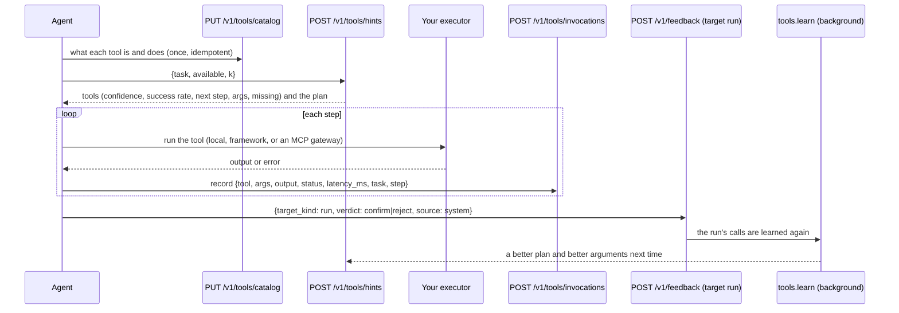

# Tool memory: which tool, which plan, which arguments

The service never runs a tool. It keeps a **catalog** of what each tool is and does, records what
your agent called and whether the run succeeded, and learns from that: **procedures** (the chain
that worked for a task pattern, with where each argument came from), running **statistics** per
tool, **graph edges** from what the calls touched, and **approval patterns** from what reviewers
let the agent do. **Tool hints** read all of it back in one answer.

## The loop



The run's verdict is what makes this work (the harness sends a `system` verdict from the
run's final status; a judge or a person overrides it, human > judge > system): only a successful run validates a procedure. A
run nobody labelled is no evidence unless one of its calls failed, and a `system` reject of a
run whose calls all worked (a time limit, a model error, a stall) is none either: the run
failed, not its procedure.

## Routes

| Route | Purpose | SDK |
| --- | --- | --- |
| `PUT /v1/tools/catalog` | upsert catalog entries by name (idempotent) | `ctx.advanced.tools.put_catalog([...])` |
| `GET /v1/tools?names=…` | the catalog visible in this scope, by name, with statistics (cursor paged; a page holds the whole 500-entry catalog by default). `ETag` + `Cache-Control: private, no-cache`: send it back in `If-None-Match` and an unchanged catalog is a `304` without a body — how a harness refreshes approval tiers cheaply. Each entry says whether tool search finds it as it is now (`indexed`: false right after it was published or changed, until its `tools.index` job ran): a harness waits for it before a tenant's first hints | `ctx.advanced.tools.catalog(names=…)` (follows the cursor); `catalog_if_changed(names, etag=)` → `(entries | None, etag)`, `None` when unchanged |
| `POST /v1/tools/invocations` | record one call (idempotent on run + step + tool + arguments) | `ctx.record_tool(...)` |
| `POST /v1/feedback` (target `run`) | label a run successful or not | `ctx.feedback("run", run_id, "confirm", source="system")` |
| `POST /v1/tools/hints` | the tools that fit, best first: confidence, success rate, next step, the arguments found and the ones missing; the plan | `ctx.tool_hints(task, available=…, k=…)` |
| `GET /v1/tools/approval-suggestions?tool=…` | approval rules this agent's reviewed calls support, most supported first (cursor paged) | `ctx.advanced.tools.approval_suggestions(tool=…)` |
| `POST /v1/tools/approval-suggestions/{suggestion_id}/accept` | accept one: its rule is written into the tool's `approve_when` | `ctx.advanced.tools.accept_suggestion(id)` |

`POST /v1/context` answers the same hints inline when asked (`tools: {available, k}`; the SDK's
`ctx.context(query, tools=[...names])`), and
tool-call feedback (`POST /v1/feedback`, `target_kind: tool_call`) feeds the statistics and the
approval patterns.

## The catalog

```python
await ctx.advanced.tools.put_catalog(
    [
        {
            "name": "erp-create_po",
            "description": "Create a purchase order",
            "input_schema": {
                "type": "object",
                "properties": {"supplier_id": {"type": "string"}, "amount": {"type": "number"}},
                "required": ["supplier_id", "amount"],
            },
            "argument_entity_types": {"supplier_id": "ORG"},
            "side_effects": "write",  # read | write | irreversible; omit when unknown
            "source": "mcp",
            "server": "erp",
            "redact": ["auth.token"],  # argument paths never stored
        }
    ]
)
entries = await ctx.advanced.tools.catalog(names=["erp-create_po"])  # .side_effects, .stats
```

An entry is one row per name in the caller's workspace (or tenant-wide without one); a
workspace's own entry shadows the tenant's. A changed input schema is a new `version`; an
unchanged entry is left as it is. Entries are embedded (name, description, argument names, and
what the input schema says each argument is: `properties.<arg>.description`, nested objects and
array items included, three levels deep, each distinct text once, at most 4,000 characters) into
the `tools` search collection by a background job, so a tool whose purpose only an argument's
description names is found. `periodic.tools_refresh` indexes what no job did: an entry with
no record (one a recorded call created, a collection a model change made new) and one whose
text a release changed; `memory-reindex` re-embeds the whole catalog. `required` defaults to
the input schema's.

## Recording a call

```python
result = await ctx.record_tool(
    "erp-get_stock",
    {"sku": "A4-80"},
    output={"on_hand": 95},
    status="ok",  # ok | error | timeout | rejected | cancelled
    latency_ms=41.0,
    task="order 500 sheets of A4 paper from Acme",
    step=0,
    visibility="PRIVATE",
)
```

`task` is the question, in words: it is normalised into a typed-placeholder **pattern**
(`order {num} sheets of {id} paper from {entity}`) that procedures are keyed on, so two phrasings
of the same request pool their runs. `step` makes a chain a chain. `visibility` defaults to
`PRIVATE`: the agent's own records, which are learned **per agent, across all of its users**
(the agent's [learned skills](skills.md)). Calls shared with `AGENT_GROUP`, `WORKSPACE` or
`TENANT` are learned for that audience instead, to learn across agents. Every new call is
counted on the tool (calls, successes, latency).

## Tool hints

```json
{
  "tools": [
    {"name": "erp-create_po", "confidence": 0.74, "success_rate": 1.0, "next": true,
     "args": {"amount": 700, "cost_centre": "CC-7"},
     "missing": [{"arg": "supplier_id", "question": "erp-create_po needs 'supplier id': what should it be?"}]},
    {"name": "erp-get_budget", "confidence": 0.74, "success_rate": 1.0, "args": {"cost_centre": "CC-7"}},
    {"name": "calendar-book", "confidence": 0.21, "missing": [{"arg": "when", "question": "calendar-book needs 'when': what should it be?"}]}
  ],
  "plan": {"id": "prc_…", "title": "Order supplies", "steps": ["erp-search_supplier", "erp-get_budget", "erp-create_po"], "success_rate": 1.0, "runs": 3}
}
```

```python
hints = await ctx.tool_hints("order 500 sheets of A4 from Acme", available=tools, k=8)
hints.tools  # best first, only tools in `available`
hints.next  # the plan's next step, else the best tool: .name .confidence .args .missing
hints.plan  # the learned procedure: .steps (tool names), .success_rate, .runs | None
```

- **tools** — hybrid search (dense + BM25) over the catalog, narrowed to `available` (a
  callable tool the search missed still competes on its record), scored by relevance × how
  well the tool has worked, with a bonus for the plan's tools, its next step, and recent use.
  `confidence` is that score as 0..1 (`1 - e^-score`, same order); `success_rate` is the share
  of the tool's recorded calls that succeeded (absent: never called). When nothing matched the
  task (the catalog is not indexed yet) and no plan is learned, there are no candidates and no
  `next`: a ranking of zeros is the toolbox in alphabetical order, no hint. A general view —
  a tool whose name says `overview`, `summary` or `dashboard` — is left out when it ranks
  below a specific tool (ranked first, it is what the task asked for; a plan step stays).
- **plan / next** — the stored procedure whose pattern matches the task and whose tools are all
  callable; `next: true` marks the step this run has not done yet (without a plan, the best
  candidate). A tool that changes something (its catalog risk is not `read`) is never `next`
  for a task that is a question: the best candidate that only reads is.
- **args** — every candidate's arguments, first found wins: the procedure's binding (an
  earlier step's output in this run, or the constant every successful run used, unless the
  task names another value of its kind) → the
  knowledge graph (an entity of the argument's type named in the task; for an `…id` argument,
  the id a tool returned for it) → a `name: value` line of a pinned profile block, or a memory
  whose predicate is the argument's name → a value the task itself names → a value a memory in
  hand names right after the argument's words ("their supplier id is SUP-40" for
  `supplier_id`). A value named right after an argument's own words fills that argument and no
  other ("for cost centre CC-7" is `cost_centre`, never `supplier_id`), as does an identifier
  that spells it (`SKU-22` is `sku`, never the quote `Q-1183`) and one of the shape of the
  example the argument's schema gives (`"The store's id, such as S12."`: `S40`, and the `S7` of
  "Store S7"; `examples` count too); a name is never an `…id` argument's (it is left for the
  argument that takes a name), and an identifier never fills an argument only because its name
  asks for one (the asset tag `LT-2290` is no `user_id`). Each value is used once, a currency
  on either side of an amount is the amount's (`700 EUR`), a value for a number argument is a
  number (`"700 EUR"` → `700`), and no number is read out of an identifier (`ST-101` is no
  `max_units`).
- **missing** — required arguments nothing filled, with the question to ask (and the
  `entity_type` the argument names, when the catalog says) — but not a free-text argument the
  catalog describes (a team's name, a question, with no identifier, number or entity to find):
  the request says it in words the hints do not extract, and the model words it from there.

## Procedures and the learning job

`tools.learn` runs after every outcome label and every five minutes. It reads the calls not
learned yet (a partial index), re-mines every task pattern they touch from that pattern's newest
calls (the prefix-tree miner: coverage first, then length; a failed call and its retry of the
same tool are one step, which the call that worked stands for; failures are kept as the step's
failure modes) and updates that pattern's one stored procedure — a delta, never a rewrite of the
others. A step's argument is a learned literal only when it is a constant of the task: the same
value in runs about at least two different things (the values their tasks named) and named by
none of them — a value each run took from its own task (`style ST-101`) is the next task's to
give, and a literal is never prefilled for a task that names another value of its kind. Under
Code Mode the steps are the tools the script called (recorded from the gateway's log), never the
meta-tools (`list_tool_files`, `read_tool_file`, `get_tool_docs`, `execute_tool_code`). A procedure is **active** (offered) once at least 2 runs support it and
at least 60% succeeded; it is **retired** when that stops holding and **rejected** by a
`reject` verdict on it (`target_kind: procedure`) or a [dismissal](skills.md) until its steps
change. An active procedure is the agent's **learned skill** for that kind of task: the
context offers it in full ([skills.md](skills.md)).

With the tenant's model (use `procedure_abstraction`, the recording principal's key), an active
procedure whose steps changed is distilled into a title and a strategy from the runs that
succeeded and those that failed ("what to avoid"). Without one, the title is the pattern and the
strategy the miner's own rendering.

The same job writes graph edges in the `procedural` layer: a call with a typed argument
(`argument_entity_types`) `used_entity` the entity it names; when that call succeeded and returned
an id field, the entity is `identified_by` the id. That is how "Acme" becomes `supplier_id`
`SUP-42` in a later hint's `args`.

## Approval suggestions

A verdict on a tool call (`POST /v1/feedback` with `target_kind: tool_call`, `metadata.tool` and,
ideally, `metadata.args`; an `edit`'s correction stands in for the arguments) is counted per
(agent, tool, argument shape). The shape is value-free: each argument with its kind, numbers by
order of magnitude (`amount:num:1e4,supplier:str`). With at least 5 decisions, 95% approved
suggests `auto_approve` and 50% or fewer `always_ask`. Nothing applies them on its own.

Only a real decision counts: one on an interrupt (`metadata.interrupt_id`) of the calling run
(`agent_run_id`), naming its `reviewer`, counted once per interrupt however many feedback ids
carry it; and an approval only once that run recorded the call it approved — that tool with
those arguments — each recorded call backing one counted approval: the interrupt id is the
client's, so a new id does not make one call back a second approval. An approval sent before the approved call is recorded (the harness sends it as
the run resumes) is looked at again every 30 seconds, ten times, then counts nothing. A
rejection or an edit only makes the tool ask more, so it needs no recorded call. And
`auto_approve` is offered only for a tool without an `approve_when`: an administrator's rule (or
one accepted before) is never relaxed by what was learned; `always_ask` may still be added.
`auto_approve` also needs at least 2 different reviewers among the counted approvals of that
shape (read from the decisions themselves, the newest 500 on the tool): one person's approvals,
however many, suggest nothing.

What this does not stop: the reviewer, the run and the interrupt id are what the sending
credential says. A key that may act as the agent can record a call and then approve it, naming
any reviewer. An interrupt id minted by the service would not change that, since the same key
would ask for it: closing it takes decisions sent with the reviewer's own credential.

```python
for s in await ctx.advanced.tools.approval_suggestions(tool="erp-create_po"):
    print(s.id, s.arg_shape, s.suggestion, s.support, s.approve_rate, s.accepted)
entry = await ctx.advanced.tools.accept_suggestion(s.id)  # the catalog entry, updated
print(entry.approve_when)
```

Accepting composes the suggestion into the tool's catalog `approve_when` expression (the
harness evaluates it before a call; `trellis.memory.approval.evaluate` is the reference). The
rules of the route:

* only the agent whose decisions the suggestion was learned from may accept it (bind the same
  `agent_id`); any other caller gets `404`;
* `409` when the decisions no longer support the suggestion, or when it would auto-approve an
  `irreversible` tool (those calls are always asked about; `always_ask` may be accepted for any
  tool);
* accepting one already part of `approve_when` returns the entry unchanged.

## Learned skills

What an agent's successful runs proved is offered back to that agent on its own, in its
context, with nobody publishing or approving it: see [skills.md](skills.md) (`GET /v1/skills`
to see them, `POST /v1/skills/{skill_id}/dismiss` to stop one).

## Tools in context: what is sent, what comes back

The same tool information reaches the service three ways and comes back two ways. This is the
whole round trip as the harness (`agent-harness`) drives it; a caller without the harness
sends the same requests itself.

```mermaid
sequenceDiagram
  participant H as Harness (one run)
  participant S as Memory service
  participant W as Worker
  Note over H: the agent's toolbox is resolved (own tools, MCP via Bifrost, OpenAPI)
  H->>S: PUT /v1/tools/catalog {tools: [name, description, input_schema, source, server, side_effects or annotations]}
  Note over H,S: only entries not published before (digest), in the background
  H->>S: POST /v1/context {query: task, tools: {available: [names]}, window}
  Note over H,S: the run's own tools, always; hints only for 5 or more (TOOL_HINTS_MIN)
  S-->>H: {bundle_id, rendered, token_estimate, evidence_status, tools: [{name, confidence}]}
  Note over H: learned skills in rendered; tools narrow the tools the model is offered
  H->>S: POST /v1/tools/invocations {tool, args, output, status, error_class, latency_ms, task, step}
  Note over H,S: one per call the agent makes, idempotent on (run, step, tool, args)
  S->>W: tools.learn, tools.index
  W->>S: procedures per (agent or audience, task pattern), tool statistics
  Note over H,S: the next run's context carries what was learned
```

### What the harness sends

| When | Request | Tool fields | Where in the harness |
|---|---|---|---|
| a run's toolbox is resolved | `PUT /v1/tools/catalog` | `name`, `description`, `input_schema`, `source` (`local`, `mcp`, `openapi`, `a2a`), `server`; `side_effects` where the harness knows them (local and OpenAPI tools), the server's `annotations` for MCP tools (the service derives the tier) | `tools/toolbox.py`, `governance/catalog.py` (`entry`, `MemoryCatalog.publish`) |
| before the model runs | `POST /v1/context` | `tools.available`: the run's own tool names (not the memory tools), always; `tools.k` defaults to 8 | `agent.py::remembered` |
| each tool call | `POST /v1/tools/invocations` | `tool`, `args`, `output`, `status` (ok, error, timeout, rejected, cancelled), `error_class`, `latency_ms`, `task`, `step` | `clients/memory.py::record_tool` |
| on demand, mid-run | `POST /v1/tools/hints` | `task`, `available` (the run's tool names) | the `tool_search` memory tool |

Arguments are redacted per the catalog entry's `redact` list before they are stored.

### What comes back

`POST /v1/context` with `format=prompt` (the harness's default) returns:

| Field | What it holds | Who uses it |
|---|---|---|
| `rendered` | the prompt text. With tools it has `## Learned skills for this task` (each as `- name: tool -> tool (worked N% of M runs)`, what fixed a failing step under it, and `- adds to your skill <name>: …` when the runs opened one of the agent's own skills) and, for five or more tools, `## Tools`: the best three tools and the next step, each as `- <tool> (confidence 0.74, next step): <arg> = <value>, …; missing <arg>: <question>`; with the profile, summary, conversation, memories and the rest | the model reads it |
| `tools` | the tools that fit the task, best first (at most `k`), each `{name, confidence}`, only when five or more tools (or the catalog) were sent | the harness offers only these to the model |
| `bundle_id`, `token_estimate`, `evidence_status` | as for any context | `/v1/verify`, budgeting, abstaining |

`format=full` returns the same content as data instead: `skills` (`id`, `name`, `steps` as
tool names, `with_skill`, `fixes`, `success_rate`, `runs`) and `tools`, each with `confidence`,
`success_rate`, `next`, `args` and `missing`, exactly as `POST /v1/tools/hints` returns them.

Nothing tool-related is in the context when `tools` is not sent: no learned skills, no hints, no
tools. Fewer than five tools get the learned skills and no hints: the model already sees every
tool, and the hints are read after retrieval, so they would only add latency.
`tools: {available, hints: false}` (`ctx.context(q, tools=[...], hints=False)`) keeps the
learned skills and leaves the hints out, for a caller that offers the model every tool anyway
(the harness's `without={"hints"}`).

## What this area does not do

* it does not execute anything, ever;
* it does not write skills anywhere: a learned skill lives in the context of its agent;
* it does not invent a plan: a task nobody has completed successfully has none;
* it does not learn from a run you never labelled until a day has passed;
* it does not make tool outputs searchable knowledge: `PRIVATE` keeps them to the agent.
